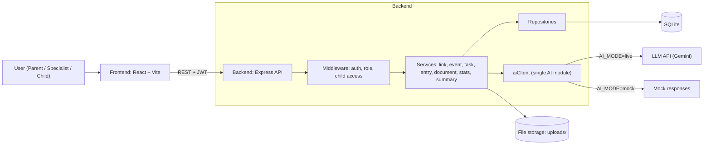
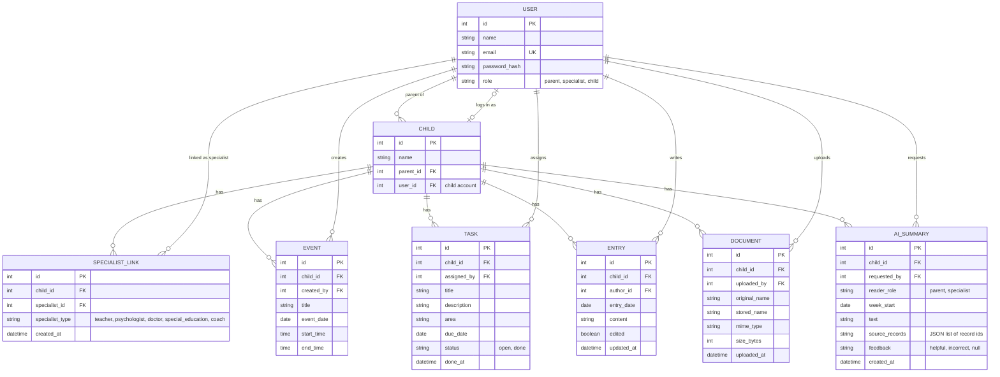
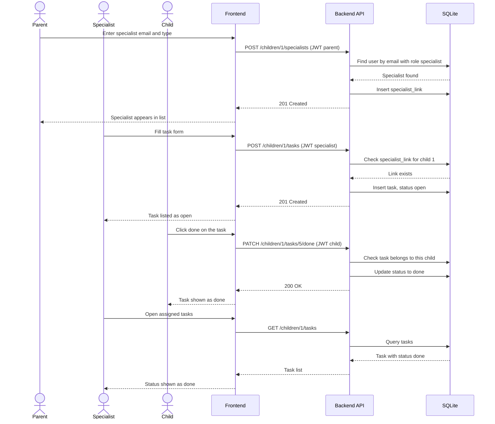
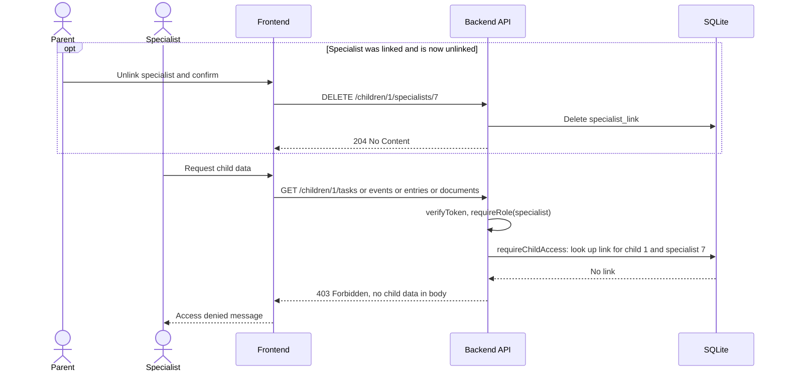
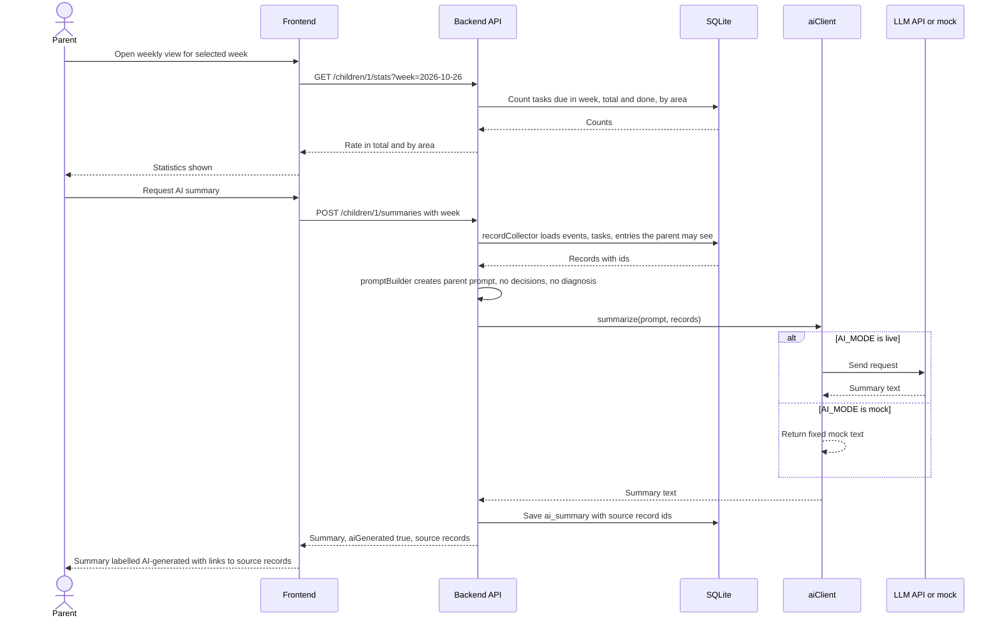

# Software Design Document (SDD)

**Team name:**  StepTrack  
**Version:** ☒  First version (Week 6) ☐ Final (Week 10)  
**Last updated:** 2026-10-29

---

## 1. Architecture Overview

StepTrack is a three-tier web application: a React single-page frontend, a Node.js + Express REST API, and a SQLite database. The backend is layered (routes → middleware → services → repositories), so access control and business rules live in one place and are never left to the frontend. The AI provider is reached only through one backend module (aiClient) that has a mock mode for tests and CI.

### Technology Stack

| Layer | Technology |
|---|---|
| Frontend | React (Vite), React Router, fetch/axios |
| Backend | Node.js + Express, JWT (`jsonwebtoken`), `bcrypt` for password hashing, `multer` for file upload |
| Database | SQLite (`better-sqlite3`), created and filled by a seed script (synthetic data only) |
| AI | Gemini API, accessed only through `backend/src/ai/aiClient.js`; `AI_MODE=mock` for tests and CI |
| Testing | Jest + Supertest (backend unit and API), Vitest (frontend), Playwright (end-to-end) |
| CI | GitHub Actions |

## 2. Module Design

| Module | Main components | Implements requirements |
|---|---|---|
| M1 – Login and Roles | **Frontend:** `LoginPage`, `AuthContext`, `ProtectedRoute`, role-based router (parent dashboard, specialist child list, child task list). **Backend:** `authRoutes`, `authService` (bcrypt compare, JWT sign), middleware `verifyToken`, `requireRole`. **DB:** `users`. | FR-M1-01, FR-M1-02, FR-M1-03, FR-M1-04, FR-M1-05, NFR-01 |
| M2 – Specialist Linking | **Frontend:** `LinkedSpecialistsPage`, `LinkSpecialistForm`, `ConfirmDialog`, `SpecialistChildList`. **Backend:** `childRoutes`, `linkService` (find specialist by email, create/remove link), middleware `requireChildAccess`. **DB:** `children`, `specialist_links`. | FR-M2-01, FR-M2-02, FR-M2-03, FR-M2-04, FR-M2-05, FR-M2-06 |
| M3 – Weekly Schedule | **Frontend:** `WeeklyCalendar` (Mon–Sun), `EventForm`, `ChildEventList` (read-only). **Backend:** `eventRoutes`, `eventService` (validation, week range query). **DB:** `events`. | FR-M3-01, FR-M3-02, FR-M3-03, FR-M3-04 |
| M4 – Tasks | **Frontend:** `TaskForm`, `AssignedTaskList` (status for the assigner), `ChildTaskList` with "done" button. **Backend:** `taskRoutes`, `taskService` (the child may only change status; create, edit and delete are role-restricted). **DB:** `tasks`. | FR-M4-01, FR-M4-02, FR-M4-03, FR-M4-04, FR-M4-05, NFR-04 |
| M5 – Specialist Entries | **Frontend:** `EntryForm`, `EntryList` with "edited" badge. **Backend:** `entryRoutes` (parent and specialist roles only), `entryService` (sets `edited = 1` on update). **DB:** `entries`. | FR-M5-01, FR-M5-02, FR-M5-03, FR-M5-04 |
| M6 – Documents | **Frontend:** `DocumentUpload`, `DocumentList`. **Backend:** `documentRoutes` (parent and specialist roles only), `uploadMiddleware` (multer: PDF/image MIME filter, 5 MB limit), `documentService`. **Storage:** `uploads/` folder with generated file names. **DB:** `documents`. | FR-M6-01, FR-M6-02, FR-M6-03, FR-M6-04, FR-M6-05 |
| M7 – Weekly Statistics | **Frontend:** `StatsPanel` (total rate and rate by area). **Backend:** `statsRoutes`, `statsService` (done / assigned for tasks due in the week; returns `0 tasks` instead of dividing by zero). Not available to the child role. | FR-M7-01, FR-M7-02, FR-M7-03, FR-M7-04, NFR-03 |
| M8 – Role-based AI Summary | **Frontend:** `SummaryPanel` ("AI-generated" label, source links, helpful / incorrect buttons, error state). **Backend:** `summaryRoutes`, `summaryService`, `recordCollector` (role-filtered records), `promptBuilder` (parent and specialist prompts), `aiClient` (single AI module, live and mock mode selected by `AI_MODE`). **DB:** `ai_summaries`. | FR-M8-01, FR-M8-02, FR-M8-03, FR-M8-04, FR-M8-05, FR-M8-06, FR-M8-07, FR-M8-08 |

Non-functional requirements not tied to one module: NFR-02 (a seed script `npm run seed` creates all data, which is synthetic) and NFR-05 (a README describes `npm install`, `npm run seed`, `npm run dev`; SQLite needs no external service).

---

## 3. Data Model

A child is represented by a `CHILD` record owned by one parent. The child logs in with their own user account (role `child`), which is linked to the `CHILD` record. A specialist reaches a child only through a row in `SPECIALIST_LINK`, which is the single source of truth for access control.

Notes:
- `SPECIALIST_LINK` has a unique constraint on (`child_id`, `specialist_id`). Unlinking deletes the row, and the next request from that specialist fails the `requireChildAccess` check immediately.
- `TASK.status` changes only from `open` to `done`; the child can change nothing else.
- `ENTRY.edited` is set to true by the service on every update.
- Documents are stored on disk under a generated name; the original name is kept only in the database.

---

## 4. API / Interfaces

All endpoints except login require `Authorization: Bearer <JWT>`. `:childId` routes also pass `requireChildAccess`. Errors: `401` no or invalid token, `403` role or child access not permitted, `400` validation error with the field name, `404` unknown record.

| Method | Endpoint | Description | Access | Module |
|---|---|---|---|---|
| POST | `/api/auth/login` | Log in with email and password; returns JWT and role. Wrong credentials give a generic error. | Public | M1 |
| GET | `/api/auth/me` | Current user and role. | Any role | M1 |
| GET | `/api/children` | Children visible to the user: own children (parent), linked children (specialist), own record (child). | Any role | M2 |
| GET | `/api/children/:childId/specialists` | List specialists linked to the child. | Parent | M2 |
| POST | `/api/children/:childId/specialists` | Link a specialist by `email` and `type`; error if the email is not a registered specialist. | Parent | M2 |
| DELETE | `/api/children/:childId/specialists/:specialistId` | Unlink a specialist (the UI asks for confirmation first). | Parent | M2 |
| GET | `/api/children/:childId/events?week=YYYY-MM-DD` | Events of the selected week. | Parent, linked specialist, child | M3 |
| POST | `/api/children/:childId/events` | Add an event (`title`, `date`, `startTime`, `endTime`). | Parent, linked specialist | M3 |
| GET | `/api/children/:childId/tasks?week=YYYY-MM-DD` | Tasks of the child (the child only receives their own). | Parent, linked specialist, child | M4 |
| POST | `/api/children/:childId/tasks` | Assign a task (`title`, `description`, `area`, `dueDate`). | Parent, linked specialist | M4 |
| PATCH | `/api/children/:childId/tasks/:taskId/done` | Mark a task as done. | Child | M4 |
| GET | `/api/children/:childId/entries` | List all observation entries. | Parent, linked specialist | M5 |
| POST | `/api/children/:childId/entries` | Add a dated observation. | Linked specialist | M5 |
| PUT | `/api/children/:childId/entries/:entryId` | Edit an entry; it is then marked "edited". | Entry author | M5 |
| GET | `/api/children/:childId/documents` | List documents (name, type, uploader, date). | Parent, linked specialist | M6 |
| POST | `/api/children/:childId/documents` | Upload a PDF or image (multipart, max 5 MB). | Parent, linked specialist | M6 |
| GET | `/api/children/:childId/documents/:docId/download` | Download a document. | Parent, linked specialist | M6 |
| GET | `/api/children/:childId/stats?week=YYYY-MM-DD` | Completion rate in total and by area. | Parent, linked specialist | M7 |
| POST | `/api/children/:childId/summaries` | Generate the AI summary for `week`; returns text, `aiGenerated: true`, and source records. | Parent, linked specialist | M8 |
| POST | `/api/summaries/:summaryId/feedback` | Mark a summary `helpful` or `incorrect`. | Summary requester | M8 |

---

## 5. Critical Flows

### Flow 1: Parent links a specialist, the specialist assigns a task, the child completes it

Related requirements: FR-M1-01, FR-M2-01, FR-M4-01, FR-M4-03, FR-M4-04.

### Flow 2: An unlinked specialist cannot access the child's data

Related requirements: FR-M2-04, FR-M2-05, FR-M5-03.

### Flow 3: Parent views the weekly statistics and the AI summary

Related requirements: FR-M7-01, FR-M7-02, FR-M8-01, FR-M8-03, FR-M8-04.

If the AI call fails, `aiClient` raises an error, the API answers 502 with a message, and only the summary panel shows the error (FR-M8-07).

---

## 6. User Interface

Screens follow the example screens in the assignment (Appendix A). Add screenshots or wireframes to `docs/img/` using the file names below.

| Screen | Image | Module |
|---|---|---|
| Login (email, password) | `docs/img/login.png` | M1 |
| Parent – weekly dashboard (schedule, tasks, recent entries, completion rate by area, AI summary) | `docs/img/parent-dashboard.png` | M3, M4, M5, M7, M8 |
| Parent – linked specialists (link form, list, unlink confirmation) | `docs/img/parent-specialists.png` | M2 |
| Parent – documents (upload, list, download) | `docs/img/parent-documents.png` | M6 |
| Child – my tasks and upcoming events | `docs/img/child-tasks.png` | M1, M3, M4 |
| Specialist – child list and child profile (entry form, AI summary, entry points for tasks and documents) | `docs/img/specialist-profile.png` | M2, M5, M6, M8 |
| Specialist – assign and track tasks | `docs/img/specialist-tasks.png` | M4 |

---

## 7. Change Log

| Date | Change | By |
|---|---|---|
| 2026-10-29 | First version | Asel Ece Birlikbaş |
