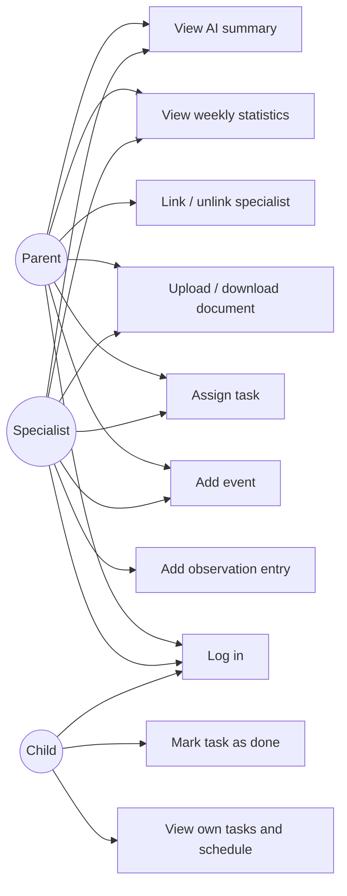

# Software Requirements Specification (SRS)

**Team name:**  StepTrack

**Version:** ☒ First version (Week 6) ☐ Final (Week 10)  
**Last updated:** 2026-10-29

## 1. Introduction

**Purpose of the system** :
The system is a web-based decision-support platform designed to track a child's development. It brings together parents, professionals, and the child through a shared weekly schedule, a list of tasks, and observation records. An artificial intelligence component summarizes these records according to each user's specific role; the AI ​​serves solely to support the decision-making process—every suggestion it offers is presented explicitly as a "recommendation" accompanied by the source records, with the final decision always resting with a human.

**Users of the system:**

| User type | Description |
|---|---|
|Parent|	Owns the child's data and sees all records. Links and unlinks specialists. Adds events and tasks, uploads documents.|
|Specialist|	Teacher, psychologist, doctor, special education teacher or coach. Works only with the children they are linked to. Adds events, tasks, dated observations and documents. |
|Child | 	Sees only their own tasks and schedule and marks tasks as done. Cannot see observations or documents.|

---

## 2. Functional Requirements

### M1 – Login and Roles

| ID | Requirement | Priority |
|---|---|---|
| FR-M1-01 | The system shall allow a registered user to log in with email and password. | Must |
| FR-M1-02 | The system shall reject a login with wrong credentials and show an error message that does not reveal which field was wrong. | Must |
| FR-M1-03 | The system shall take the user's role (parent, specialist or child) from the account; the user shall not choose it at login. | Must |
| FR-M1-04 | The system shall show each role only its own screens (parent dashboard, specialist child list and profile, child task list). | Must |
| FR-M1-05 | The system shall answer every API request without a valid token with 401, and every request that the user's role does not permit with 403. | Must |

### M2 – Specialist Linking

| ID | Requirement | Priority |
|---|---|---|
| FR-M2-01 | The system shall allow a parent to link a registered specialist to the child by entering the specialist's email and type. | Must |
| FR-M2-02 | The system shall show an error and create no link when the entered email does not belong to a registered specialist. | Must |
| FR-M2-03 | The system shall list the specialists linked to the child for the parent. | Must |
| FR-M2-04 | The system shall allow a parent to unlink a specialist after a confirmation. | Must |
| FR-M2-05 | The system shall answer every API request about a child from a specialist who is not linked to that child with an error (403) and return no data. | Must |
| FR-M2-06 | The system shall list for a specialist only the children they are linked to. | Must |

### M3 – Weekly Schedule

| ID | Requirement | Priority |
|---|---|---|
| FR-M3-01 | The system shall allow a parent and a linked specialist to add an event with title, date, start time and end time to the child's schedule. | Must |
| FR-M3-02 | The system shall reject an event with a missing title or date and show which field is missing. | Must |
| FR-M3-03 | The system shall list the events of a selected week in a weekly view (Monday to Sunday). | Must |
| FR-M3-04 | The system shall show the child their own upcoming events in read-only form. | Must |

### M4 – Tasks

| ID | Requirement | Priority |
|---|---|---|
| FR-M4-01 | The system shall allow a parent and a linked specialist to assign a task to the child with title, description, development area and due date. | Must |
| FR-M4-02 | The system shall show the child only their own tasks. | Must |
| FR-M4-03 | The system shall allow the child to mark one of their tasks as done. | Must |
| FR-M4-04 | The system shall show the assigner the current status (open or done) of the tasks they assigned. | Must |
| FR-M4-05 | The system shall not allow a child to create, edit or delete tasks. | Must |

### M5 – Specialist Entries

| ID | Requirement | Priority |
|---|---|---|
| FR-M5-01 | The system shall allow a linked specialist to add a dated observation entry for the child. | Must |
| FR-M5-02 | The system shall mark an entry as "edited" after it has been changed. | Must |
| FR-M5-03 | The system shall show all entries of the child to the parent and to every linked specialist. | Must |
| FR-M5-04 | The system shall not show entries to the child, in the interface or through the API. | Must |

### M6 – Documents

| ID | Requirement | Priority |
|---|---|---|
| FR-M6-01 | The system shall allow a parent and a linked specialist to upload a PDF or image file for the child. | Must |
| FR-M6-02 | The system shall reject files that are not PDF or image files and files larger than 5 MB, with an error message. | Must |
| FR-M6-03 | The system shall list the child's documents with name, type, uploader and date. | Must |
| FR-M6-04 | The system shall allow the parent and linked specialists to download a listed document. | Must |
| FR-M6-05 | The system shall not show or serve documents to the child. | Must |

### M7 – Weekly Statistics

| ID | Requirement | Priority |
|---|---|---|
| FR-M7-01 | The system shall show the task completion rate (done tasks / assigned tasks) in total for a selected week. | Must |
| FR-M7-02 | The system shall show the task completion rate for the selected week by development area. | Must |
| FR-M7-03 | The system shall show 0 tasks and no error for a week in which no tasks were due. | Must |
| FR-M7-04 | The system shall show the weekly statistics to the parent and to linked specialists, and not to the child. | Should |

### M8 – Role-based AI Summary

| ID | Requirement | Priority |
|---|---|---|
| FR-M8-01 | The system shall generate a summary of the records (events, tasks, entries) of a selected week for the child. | Must |
| FR-M8-02 | The system shall use a separate prompt for the parent summary and for the specialist summary. | Must |
| FR-M8-03 | The system shall label every summary "AI-generated" and show links to the source records it is based on. | Must |
| FR-M8-04 | The system shall send to the AI only the records that the reader is allowed to see. | Must |
| FR-M8-05 | The system shall instruct the AI in every prompt not to make decisions and not to suggest a diagnosis or treatment. | Must |
| FR-M8-06 | The system shall call the AI only through a single backend module that has a mock mode, selected by a setting, for tests and CI. | Must |
| FR-M8-07 | The system shall show an error message and keep the rest of the application working when the AI call fails. | Should |
| FR-M8-08 | The system shall allow the reader to mark a summary as helpful or incorrect. | Could |

---

## 3. Non-Functional Requirements

| ID | Category | Requirement |
|---|---|---|
| NFR-01 | Security | Passwords are stored hashed, and every API endpoint except login requires a valid JWT. |
| NFR-02 | Privacy | Only synthetic data created by a seed script is used; no real personal data is stored at any stage. |
| NFR-03 | Performance | The weekly schedule, task list and weekly statistics load in under 2 seconds with the seed data on a local machine. |
| NFR-04 | Usability | A child can mark a task as done in at most 2 clicks from their task list. |
| NFR-05 | Portability | A new developer can install and run the application locally by following only the README, without cloud services. |

---

## 4. Critical Flows and Acceptance Criteria

| Flow | Related requirements | Acceptance criteria |
|---|---|---|
| Flow 1: Parent links a specialist, the specialist assigns a task, the child completes it | FR-M1-01, FR-M2-01, FR-M4-01, FR-M4-03, FR-M4-04 | **Given** a registered parent, a registered specialist and the parent's child exist **When** the parent links the specialist by email, the specialist assigns a task to the child, and the child marks it as done **Then** the specialist sees the task with the status "done". |
| Flow 2: An unlinked specialist cannot access the child's data | FR-M2-04, FR-M2-05, FR-M5-03 | **Given** a specialist who was never linked to the child, or was unlinked by the parent **When** the specialist requests the child's tasks, events, entries or documents through the API **Then** every request is answered with an error (403) and no data about the child is returned. |
| Flow 3: Parent views the weekly statistics and the AI summary | FR-M7-01, FR-M7-02, FR-M8-01, FR-M8-03, FR-M8-04 | **Given** a parent is logged in and the child has tasks, events and entries in the selected week **When** the parent opens the weekly view and requests the AI summary **Then** the completion rate is shown in total and by development area, and the summary is shown labelled "AI-generated" with links to its source records. |

---

## 5. Use Case Diagram

---

## 6. Change Log

| Date | Change | By |
|---|---|---|
| 2026-10-29 | First version | Ayşe Sena Ünver |
