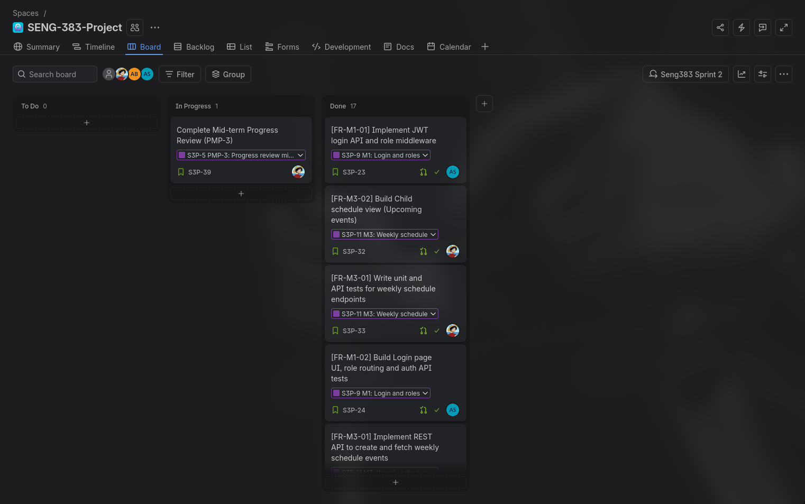

# Project Management Plan (PMP)

| Section | Content | Required by |
|---|---|---|
| PMP-1 | Project, Jira setup, team and roles | Week 6 |
| PMP-2 | Work packages (epics) and sprint plan | Week 6 |
| PMP-3 | Progress review: mid-term (v0.1) | Mid-term evaluation (Week 8 / 9) |
| PMP-4 | Progress review: v0.2 | Week 10 |
| PMP-5 | Progress review: final (v1.0) | Final evaluation |
| PMP-6 | Retrospective | Final evaluation |

---

## PMP-1. Project and Team

### Project and Jira Setup

**Project in one sentence:**  AI-assisted child development tracking for parents, kids, and specialists.

**Jira project key:** S3P 

**Jira board link:** https://dotokafu.atlassian.net/jira/software/projects/S3P/boards/1?filter=&groupBy=none 

### Team and Roles

| Name | Jira / GitHub username | Role |
|---|---|---|
|Unay Şenocak | Dotokafu/Dotokafu|Developer|
|Asel Ece Birlikbaş| Asel Ece Birlikbaş/aseleceb|Tester|
|Ayşe Sena Ünver| Ayşe Sena Ünver/senanvr|Developer/Project Manager|

---

## PMP-2. Plan

### Work Packages (Epics)

| Epic | Owner | Number of tasks | Planned sprint(s) |
|---|---|---|---|
| M1: Login and Roles |Ayşe Sena Ünver|5|Sprint 1 ,Sprint 2|
| M2: Linking Specialists |Ayşe Sena Ünver|4|Sprint 2|
| M3: Weekly Schedule |Unay Şenocak|4|Sprint 2|
| M4: Tasks |Asel Ece Birlikbaş|5|Sprint 2|
| M5: Specialist entries| |4|Sprint 3|
| M6: Documents | |4|Sprint 3|
| M7: Weekly statistics | |4| Sprint 3|
| M8: Role-based AI summary | |5|Sprint 3|

### Sprint Plan

| Sprint | Weeks | Sprint goal | Ends with |
|---|---|---|---|
| Sprint 1 |Weeks 4-6|Complete SRS, SDD,PMP-1 & PMP-2 and build walking skeleton | Walking skeleton (v0.0), Week 6 |
| Sprint 2 |Weeks 7-8|Implement M1-M4 features,complete PMP-3 and run first E2E test in CI| Release v0.1, mid-term |
| Sprint 3 |Weeks 9-10|Implement M5-M8 features,complete PMP-4 3 E2E tests| Release v0.2, Week 10 |
| Sprint 4 |Weeks 11-12|Complete E2E tests for all M1-M8,final report,PMP-5 & PMP-6| Release v1.0, final |

---

## PMP-3. Progress Review: Mid-term (v0.1)

**Jira board screenshot:**

| Epic | Planned for this point | Status (Done / In progress / Not started) |
|---|---|---|
|M1|Yes|Done|
|M2|Yes|Done|
|M3|Yes|Done|
|M4|Yes|Done|
|M5|No|Not Started|
|M6|No|Not Started|
|M7|No|Not Started|
|M8|No|Not Started|

**Changes to the plan (if any):**No changes

---

## PMP-4. Progress Review: v0.2

**Jira board screenshot:**  

| Epic | Planned for this point | Status (Done / In progress / Not started) |
|---|---|---|
| | | |
| | | |

**Changes to the plan (if any):**

---

## PMP-5. Progress Review: Final (v1.0)

**Jira board screenshot:**  

| Epic | Planned for this point | Status (Done / In progress / Not started) |
|---|---|---|
| | | |
| | | |

**Changes to the plan (if any):**

---

## PMP-6. Retrospective

- What worked well in using Jira:
- What we would do differently:
